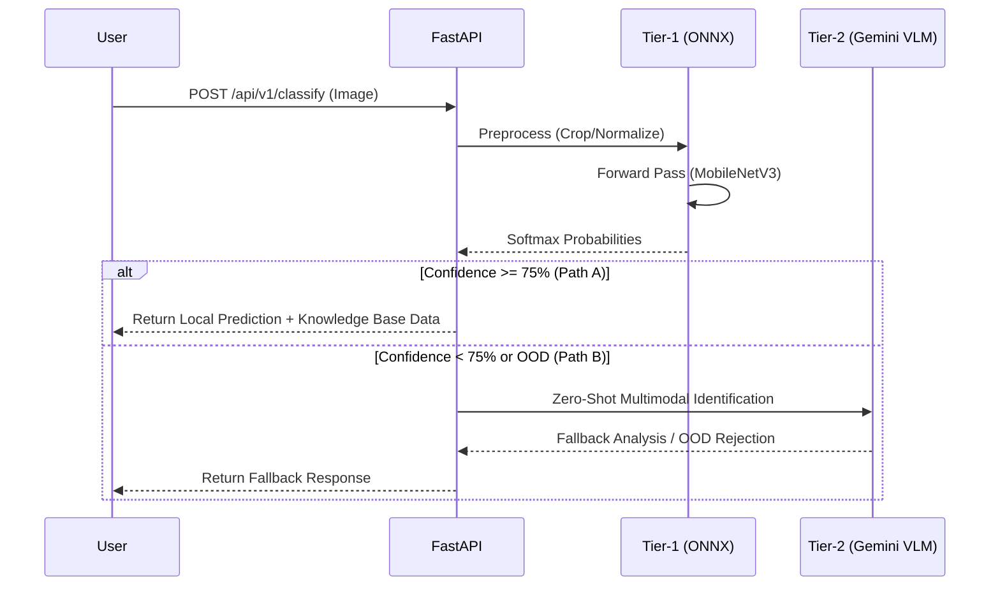

# Edge-Optimized Indian Spice Classification & Knowledge Retrieval System

> A decoupled two-tier computer vision pipeline combining sub-15ms local ONNX inference, Grad-CAM visual attribution, and multimodal zero-shot fallback.

       

---

## Core Engineering Architecture

Our system leverages a hybrid approach combining deterministic high-speed local ML with robust cloud-based Vision-Language Models (VLM).



### Flow Breakdown
1. **Input Preprocessing:** $256 \times 256 \rightarrow \text{CenterCrop } 224 \times 224 \rightarrow \text{Normalize}$
2. **Selective Classification Boundary:** A strict $\ge 75\%$ confidence gate ensures that edge cases trigger the fallback mechanism.
3. **Model Interpretability:** We maintain a native PyTorch pathway to inject a hook onto `model.features[-1]`, generating a Grad-CAM visual thermal attribution overlay for explainability.
4. **Presentation Layer:** Vanilla JS/CSS client served statically via FastAPI for minimal overhead.

---

## Verified Performance & Benchmark Metrics

| Metric | Value | Significance / Standard |
| :--- | :--- | :--- |
| **Test Accuracy** | `96.55%` | Evaluated across all 14 fine-grained classes |
| **Macro F1-Score** | `0.9738` | Unweighted average accounting for dataset class imbalance |
| **Gated Accuracy ($\ge 75\%$)** | `100.0%` | Zero false positives when the confidence gate is met |
| **Coverage Rate ($\ge 75\%$)** | `91.4%` | Proportion of queries resolved purely locally via Tier-1 |
| **Inference Latency** | `3.97 ms` | Measured CPU latency using ONNX Runtime |
| **Grad-CAM Memory Stability** | `0.41 MB delta` | Verified leak-free over 25 consecutive attribution cycles |
| **Test Suite Coverage** | `18 / 18 PASS` | Automated pytest suite validating contracts and edge cases |

---

## Dataset Taxonomy & Engineering Solutions

The model is trained on a meticulously curated taxonomy of 14 native Indian spice classes, condensed from the initial raw set of 15 directories. 

### Engineering Interventions:
- **Taxonomy Disambiguation:** 
  - Standardized duplicates: Merged `Dalchini 26` and `Dalchini(1) 61` into a unified `dalchini` class.
  - Granular segregation: Explicitly separated whole pods (`elaichi_pod`) from loose seeds (`elaichi_dana`).
- **Fine-Grained Visual Categorization (FGVC):** Solved high inter-class variance challenges specifically across the 4 red chilli cultivars: `byadgi`, `guntur_sannam`, `lavangi`, and `sankeshwari`.
- **Class Imbalance Mitigation:** Safely normalized extreme distribution skews (ranging from 13 to 86 samples per class) using class-weighted cross-entropy loss during training.
- **Data Provenance:** Non-destructive metadata indexing managed systematically via `dataset_master.csv`.

---

## API Endpoint Contract Reference

### `GET /api/v1/health`
System telemetry and model readiness check. Returns the loaded states of ONNX, PyTorch CAM, and the Fallback VLM engine.

### `POST /api/v1/classify`
- **Payload:** `image: UploadFile`, `threshold: float = 0.75`, `force_fallback: bool = False`
- **Response:** JSON payload detailing prediction `tier`, raw `confidence`, elapsed `latency_ms`, and an enriched botanical `knowledge_card`.

### `POST /api/v1/explain`
- **Payload:** `image: UploadFile`
- **Response:** JSON payload returning a Base64-encoded Grad-CAM attention heatmap overlay for strict visual explainability.

### `GET /docs`
Interactive Swagger / OpenAPI documentation auto-generated by FastAPI.

---

## Quickstart & Deployment Guide

### Local Development

```bash
# Set up isolated virtual environment
python -m venv venv
source venv/bin/activate  # Or `.\venv\Scripts\activate` on Windows

# Install dependencies
pip install -r requirements.txt

# Run the server with hot-reloading
uvicorn src.api:app --host 127.0.0.1 --port 8000 --reload
```

### Running Automated Tests

```bash
# Execute the comprehensive 18-test pytest suite
pytest -v tests/
```

### Docker Build & Run (Production)

Optimized for memory-constrained environments (<1 GB RAM) utilizing a slim runtime, CPU-only PyTorch wheels, and single-worker configuration.

```bash
# Build the optimized production image (~900 MB)
docker build -t spice-classifier .

# Run the container (pass your Gemini API key for Tier-2 fallback)
docker run -p 8000:8000 -e GEMINI_API_KEY="your_api_key_here" spice-classifier
```
